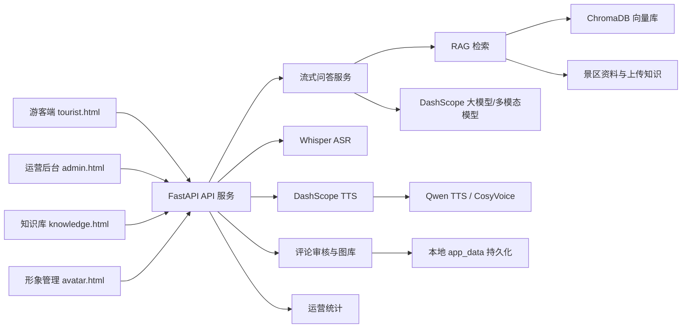

# Cyra 灵山胜境 AI 数字人导览系统技术报告

## 摘要

Cyra 是面向智慧景区服务场景设计的 AI 数字人导览系统。项目以灵山胜境为示范场景，将 Live2D 数字人、大语言模型、检索增强生成、图片理解、语音识别、语音合成、知识库管理和游客内容运营整合为一套可在 Windows 本地部署运行的完整应用。

系统面向游客提供文字、语音和图片三种交互方式，可完成景点讲解、路线推荐、图片识别、语音播报、景点图文引用和游客图文评论；面向景区管理人员提供运营数据看板、知识库管理、数字人形象管理、游客评论审核和景点图片入库能力。项目采用前后端分离的轻量架构，通过 Python 3.12 项目虚拟环境和自动化启动脚本降低部署难度，适合比赛演示、产品验证和后续工程化扩展。

**关键词：** AI 数字人；智慧景区；大语言模型；RAG；Live2D；语音交互；多模态；内容审核

---

## 1. 项目概述

### 1.1 项目背景

传统景区导览通常依赖人工咨询台、纸质地图、固定讲解牌和定时人工讲解。这些方式存在服务覆盖时间有限、重复问题占用人力、讲解内容更新不及时、个性化服务不足以及游客需求难以沉淀等问题。

随着大语言模型、语音识别、语音合成、数字人渲染和向量检索技术的发展，景区可以构建全天候、可交互、可持续维护的智能导览入口。Cyra 围绕这一需求，将游客服务与景区运营连接起来：游客获得自然的数字人导览体验，管理人员则可以维护知识、分析问题并审核游客内容。

### 1.2 产品定位

Cyra 的产品定位是“景区 AI 数字人综合导览与运营平台”，并非单一聊天机器人。系统同时覆盖：

- 数字人可视化交互；
- 景区知识问答与路线推荐；
- 语音输入、语音播报及口型动作；
- 景区图片理解与回答配图；
- 游客图文评论和后台审核；
- 景区知识与数字人形象维护；
- 游客关注点和运营数据展示。

### 1.3 建设目标

1. 为游客提供低门槛、自然化、多模态的景区咨询方式。
2. 通过景区知识库约束回答内容，降低大模型幻觉风险。
3. 通过数字人语音、口型和动作提升导览沉浸感。
4. 让知识、游客问题和游客图片形成可持续运营的数据闭环。
5. 保持系统轻量和可移植，使评委能够按照手册完成本地部署。

## 2. 用户角色与应用场景

| 用户角色 | 核心需求 | 典型操作 |
| --- | --- | --- |
| 游客 | 快速了解景点并获得路线建议 | 文字提问、语音提问、上传图片、查看景点图片、发布图文评论 |
| 景区管理员 | 维护内容并了解游客需求 | 管理知识库、查看运营数据、审核评论、筛选游客图片、管理数字人形象 |
| 比赛评委/演示人员 | 快速部署并验证完整流程 | 创建 `.venv`、双击启动、检查游客端和管理端功能 |

系统可用于游览前规划、景区现场讲解、亲子或老人友好路线推荐、景点图片辅助识别、游客内容征集和景区运营分析等场景。

## 3. 系统总体架构

### 3.1 架构设计

系统采用浏览器前端、FastAPI 后端、本地数据层和云端 AI 能力相结合的轻量架构。



### 3.2 技术分层

| 层级 | 核心组成 | 主要职责 |
| --- | --- | --- |
| 表现层 | HTML、CSS、JavaScript、Live2D、PixiJS | 页面交互、数字人渲染、流式文本、音频播放和图文展示 |
| 接口层 | FastAPI 路由 | 参数校验、文件接收、接口响应和静态媒体访问 |
| 服务层 | LLM、ASR、TTS、RAG、评论、形象和统计服务 | 封装核心业务，隔离第三方能力和数据处理逻辑 |
| 数据层 | ChromaDB、JSON、本地文件、Word/Excel 资料 | 保存知识向量、游客内容、上传文件和示范数据 |
| 外部能力层 | 阿里云 DashScope | 大模型、图片理解、Embedding 和语音合成 |

### 3.3 目录结构

```text
Cyra/
  安装环境.bat
  启动Cyra.bat
  setup_cyra_env.py
  run_cyra_demo.py
  requirements.txt
  docs/
  tests/
  src/
    backend/
      .env
      app/
        api/
        core/
        schemas/
        services/
      app_data/
      chroma_db/
    frontend/
      tourist.html
      admin.html
      knowledge.html
      avatar.html
      scripts/
      styles/
      assets/
```

## 4. 核心功能实现

### 4.1 游客端数字人导览

游客端以 Live2D 数字人为视觉中心，左侧为景点介绍和游客评论，右侧为对话记录，底部为文字、语音和图片输入区域。页面支持对话历史本地保存，并提供醒目的“清空对话”按钮。清空操作会同时重置浏览器历史记录和发送给 AI 的上下文，但不会删除知识库和后台数据。

数字人加载失败时，前端保留本地动画兜底，避免页面核心区域完全空白。游客端还针对窄屏进行响应式处理，保证主要对话和输入功能可用。

### 4.2 流式智能问答

游客问题通过 `/api/chat/stream` 发送至后端。服务根据问题构建系统提示词、对话历史、检索资料和可选图片输入，再调用 DashScope OpenAI-compatible 接口。回答以流式文本返回，前端在接收过程中逐步显示并切分适合播报的语句，从而降低等待感。

回答策略强调：

- 景区事实优先基于知识库；
- 简单问题保持简洁；
- 路线问题给出顺序、理由和人群适配建议；
- 无可靠资料时明确表达不确定性；
- 图片内容无法确认时不强行识别。

### 4.3 RAG 景区知识库

系统使用景区公开资料、管理员上传文件和 ChromaDB 构建检索增强生成链路。管理员可上传 `.txt`、`.md` 和 `.docx` 文件，后端负责文本抽取、片段切分、Embedding 生成和向量索引更新。

向量模型默认使用 `text-embedding-v4`，向量维度为 1024。除语义检索外，系统还保留本地关键词匹配与直接命中策略，以兼顾检索准确性、速度和外部服务异常时的可用性。

### 4.4 个性化路线推荐

系统根据问题中的游客特征和兴趣关键词进行轻量个性化：

- 亲子、儿童：强调轻松、互动和休息安排；
- 老人、长辈：强调少走路、慢节奏和可休息节点；
- 历史文化：强调建筑、典故和文化背景；
- 拍照打卡：强调观景角度、光线和游览时间；
- 自然休闲：强调景观、步行和安静体验。

该方案无需建立复杂用户账户体系，适合当前演示阶段，也为后续画像模型提供了可扩展接口。

### 4.5 图片理解与景点图片引用

游客可上传 JPG、PNG 或 WebP 图片并结合问题进行咨询。前端在上传前压缩尺寸和质量，后端校验 data URL 类型及大小，然后构造多模态消息交给模型处理。

系统为灵山大佛、九龙灌浴、梵宫和五印坛城设计了统一风格的景点参考插画。游客切换景点时左侧图片同步更新；当 AI 回答中提及具体景点时，前端自动在回答下方附加对应图片，并明确标注“景点参考插画”，避免将生成素材误作官方实拍证据。

### 4.6 语音识别与简体中文规范化

游客端使用浏览器 MediaRecorder 录音，通过 `/api/asr` 上传至后端。本地 Whisper 完成中文语音识别，`imageio-ffmpeg` 在系统缺少 FFmpeg 时提供可执行文件兜底。

由于 Whisper 的中文输出可能包含繁体字，系统在返回前使用 OpenCC `t2s` 转换，将语音识别文本统一为简体中文。转换只作用于 ASR 结果，不修改知识库原文和模型回答。

### 4.7 语音合成、口型与动作

系统默认通过 DashScope 调用 Qwen TTS/CosyVoice 能力，将回答转为语音。后端对语音结果进行缓存并提供音频访问接口；前端将长回答切分后排队合成和播放，减少长文本一次性请求失败的风险。

数字人语音表现采用多层驱动：

1. 根据字级时间戳推进文字显示；
2. 根据音频能量驱动嘴部开合；
3. 使用 `ParamA/I/U/E/O` 等参数表达元音口型；
4. 讲话期间叠加头部、身体和展示动作；
5. 可选接入 LAM/ARKit 表情服务获得更丰富的参数序列。

### 4.8 游客图文评论与审核入库

游客可在景点评论区域提交文字和实拍图片。图片支持 JPG、PNG、WebP，单张最大 8MB。后端重新生成文件名并保存到 `app_data`，避免使用用户文件名造成路径安全问题。

评论状态包含：

- `pending`：待审核，游客端不可见；
- `approved`：审核通过，游客端公开；
- `rejected`：已拒绝，游客端不可见。

管理员可以通过、拒绝或删除评论。审核通过且包含图片的评论可加入对应景点图库；删除评论时，系统同步删除上传原图和图库副本。该流程形成“游客贡献内容—管理员审核—景点素材沉淀”的内容运营闭环。

### 4.9 管理后台与运营分析

管理后台展示：

- 行为样本与覆盖景区；
- 灵山相关访问数据；
- 平均满意度和平均停留时长；
- 游客感受度报告和服务建议；
- 运营趋势图；
- 年龄、性别等游客画像；
- 游客热门问答；
- 图文评论审核和图片入库。

游客通过普通或流式聊天接口提问时，问题会按路线、票务交通、景点讲解、图片识别等类别归类计数。后台定时刷新后即可看到关注点变化。

### 4.10 数字人形象管理

系统提供独立的形象管理页面和 `/api/admin/avatars` 系列接口，支持查看形象清单、上传模型、编辑形象信息、激活默认形象和删除自定义形象。前端通过 manifest 获取当前生效角色，实现形象资源与游客端加载逻辑解耦。

## 5. 主要接口

### 5.1 游客接口

| 接口 | 方法 | 功能 |
| --- | --- | --- |
| `/api/health` | GET | 后端健康检查 |
| `/api/chat` | POST | 非流式问答 |
| `/api/chat/stream` | POST | 流式问答和多模态输入 |
| `/api/asr` | POST | 本地 Whisper 语音识别 |
| `/api/tts` | POST | 语音合成 |
| `/api/tts/audio/{audio_id}` | GET | 获取缓存音频 |
| `/api/comments` | GET | 获取审核通过的评论 |
| `/api/comments` | POST | 提交游客图文评论 |
| `/api/avatar/manifest` | GET | 获取当前数字人形象配置 |

### 5.2 管理接口

| 接口 | 方法 | 功能 |
| --- | --- | --- |
| `/api/admin/analytics/overview` | GET | 运营指标和热门问答 |
| `/api/admin/analytics/report` | GET | 游客感受度报告 |
| `/api/admin/knowledge` | GET | 获取知识条目 |
| `/api/admin/knowledge/upload` | POST | 上传知识文件 |
| `/api/admin/knowledge/{item_id}` | GET/PATCH/DELETE | 查看、编辑或删除知识条目 |
| `/api/admin/comments` | GET | 获取待审或历史评论 |
| `/api/admin/comments/{comment_id}` | PATCH/DELETE | 审核或删除评论 |
| `/api/admin/comments/{comment_id}/gallery` | POST | 将游客图片加入景点图库 |
| `/api/admin/avatars` | GET | 获取形象列表 |
| `/api/admin/avatars/upload` | POST | 上传数字人形象 |
| `/api/admin/avatars/{avatar_id}` | PATCH/DELETE | 编辑或删除形象 |
| `/api/admin/avatars/{avatar_id}/activate` | POST | 激活默认形象 |

## 6. 数据与持久化设计

| 数据类型 | 保存方式 | 说明 |
| --- | --- | --- |
| 景区知识向量 | ChromaDB | 运行时生成，可按资料重建 |
| 上传知识文件 | 本地文件和资源服务 | 支持文本抽取、编辑和删除 |
| 游客评论记录 | JSON | 使用锁和临时文件替换保证本地写入一致性 |
| 评论与图库图片 | `app_data` 本地目录 | 原图和入库副本分目录管理 |
| 热门问答 | 运行时统计 | 用于当前演示版本后台展示 |
| 对话历史 | 浏览器 localStorage | 仅保存于当前浏览器，可由游客主动清空 |
| API Key | `.env` | 不进入前端和 Git 仓库 |

## 7. 部署与运行设计

### 7.1 环境要求

- Windows 操作系统；
- 64 位 Python 3.12，推荐 Python 3.12.10；
- Chrome 或 Edge；
- 首次安装时可访问 PyPI；
- 运行时可访问阿里云 DashScope。

### 7.2 虚拟环境

项目不分发开发电脑生成的 `.venv`，避免绝对路径和解释器位置失效。评委首次运行 `安装环境.bat`，脚本将：

1. 检查 Python 3.12；
2. 清理损坏或版本不符的 `.venv`；
3. 在项目根目录创建新虚拟环境；
4. 安装 `requirements.txt`；
5. 导入检查核心依赖。

### 7.3 一键启动

双击 `启动Cyra.bat` 后，脚本直接使用项目 `.venv` 运行 `run_cyra_demo.py`。启动器负责检查依赖、启动 FastAPI 后端和静态前端、等待健康检查、自动选择前端可用端口，并通过 Windows 默认浏览器打开游客端和管理后台。

默认地址为：

- 游客端：`http://127.0.0.1:5173/tourist.html`
- 管理后台：`http://127.0.0.1:5173/admin.html`
- 知识库：`http://127.0.0.1:5173/knowledge.html`
- 后端健康检查：`http://127.0.0.1:8001/api/health`

## 8. 安全性与可靠性设计

### 8.1 敏感配置保护

DashScope API Key 和服务地址保存在后端 `.env`，前端只访问本地 FastAPI，不直接接触密钥。`.gitignore` 排除 `.env`、`.venv`、向量库和运行数据。

### 8.2 上传校验

- 音频校验 MIME 类型、文件大小和空文件；
- 聊天图片校验 data URL、格式和大小；
- 评论图片限制 JPG、PNG、WebP 和 8MB；
- 知识文件限制扩展名和大小；
- Live2D 上传由形象服务检查资源结构；
- 服务端生成保存文件名，避免目录穿越。

### 8.3 服务可靠性

- 后端固定使用 8001 端口并检测冲突；
- 前端从 5173 开始寻找可用端口；
- 启动器等待健康检查后再打开浏览器；
- 运行日志分别写入 backend 和 frontend runtime log；
- FFmpeg、Live2D 和问答流程均设计了不同程度的兜底；
- TTS 失败不会阻止文本回答展示。

## 9. 测试与验证

项目建立了 Python 行为测试和 Node.js 契约测试，覆盖以下方面：

- 启动器双击流程、虚拟环境切换、端口选择和后端复用；
- 游客端 Live2D、语音、图片、对话历史和清空功能；
- Whisper ASR、繁体转简体和 FFmpeg 兜底；
- 流式回答、RAG 检索、直接知识命中和个性化推荐；
- TTS 响应结构、服务切换、失败兜底和口型表达参数；
- 知识上传、编辑、删除和向量索引更新；
- 数字人形象上传、激活和前端契约；
- 游客图文评论、审核、公开、图库入库和删除清理；
- 前端中文编码和文档路径有效性。

在实际联调中已完成以下端到端验证：

1. 使用 Python 3.12 重建 `.venv` 并安装全部依赖；
2. 双击启动器后四个主要地址返回 HTTP 200；
3. DashScope DNS/TLS、问答和 TTS 接口连通；
4. 语音识别结果完成简体中文转换；
5. 评论提交后审核前不可见、审核后可见；
6. 游客图片入库后可访问，删除后原图和副本同步清理。

## 10. 项目创新点

### 10.1 从聊天机器人升级为数字人导览

系统将知识问答与 Live2D 形象、自然语音、口型和展示动作结合，使信息服务具备可感知的数字人载体。

### 10.2 多模态景区服务闭环

文字、语音、图片均可成为游客输入；回答以文字、语音、动作和景点图片组合输出，覆盖多种现场交互习惯。

### 10.3 知识可维护、回答可更新

管理员无需修改代码即可上传和编辑景区资料，知识变化可进入后续检索和问答流程。

### 10.4 游客内容转化为景区资产

游客实拍不是简单保存在评论区，而是经过管理员审核后可进入景点图库，实现用户生成内容的筛选和再利用。

### 10.5 面向评委的可复现部署

项目明确约束 Python 3.12，使用本机重建虚拟环境，并提供自动安装、双击启动、健康检查和错误保留机制，减少开发机环境依赖。

## 11. 当前边界与改进方向

当前系统以本地比赛演示和产品验证为目标，仍有以下工程化提升空间：

1. 增加管理员登录、角色权限和操作审计；
2. 将评论、统计和操作记录迁移至 SQLite 或 PostgreSQL；
3. 建立按日期、景点和游客类型聚合的运营报表；
4. 接入真实地图、客流、票务、天气和停车数据；
5. 增加多语言 ASR、翻译和多语种语音播报；
6. 将景点图库接入 AI 回答的可控检索策略和管理员排序；
7. 优化移动端、触摸屏和景区大屏交互；
8. 引入更高精度 audio-to-expression 模型改善表情和口型；
9. 增加自动化端到端浏览器测试和持续集成流程；
10. 完善数据备份、恢复、内容合规和隐私授权机制。

## 12. 结论

Cyra 完成了从游客咨询、知识检索、AI 回答、语音数字人呈现，到后台知识维护、运营分析和游客内容审核的完整业务链路。项目证明了大语言模型、RAG、语音技术和 Live2D 数字人可以在轻量本地架构中有效结合，并形成具备展示价值、实用价值和扩展潜力的智慧景区产品原型。

当前版本已具备比赛现场部署和功能验收条件。后续通过权限系统、数据库、真实业务数据和景区系统接口的进一步接入，可逐步演进为面向实际景区运营的智能导览平台。
