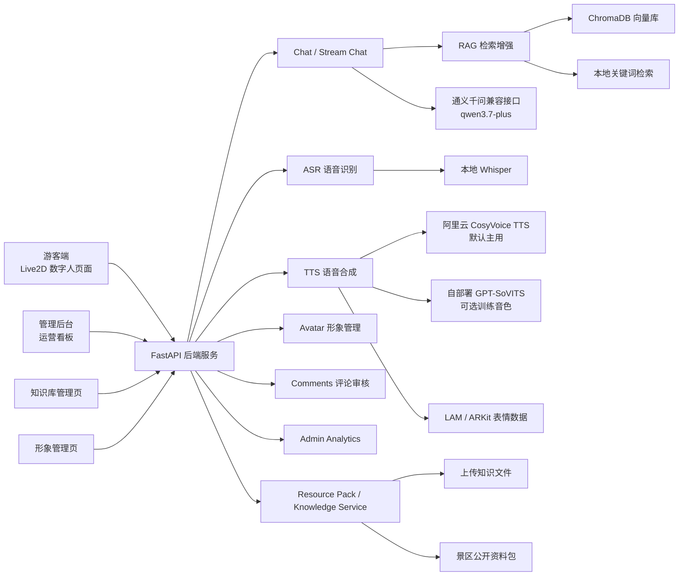
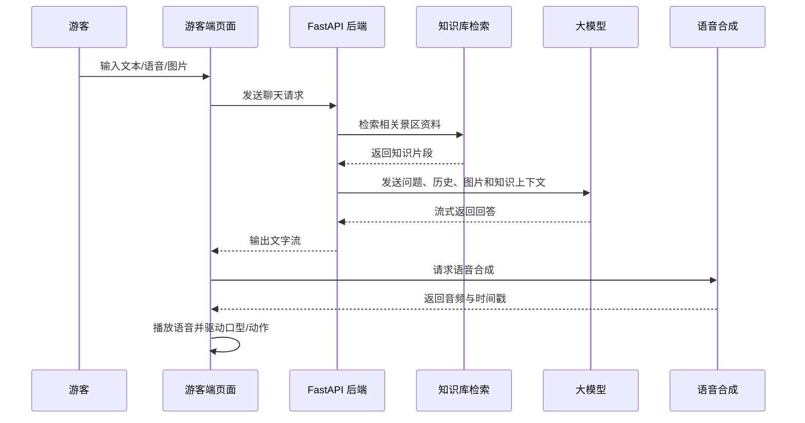

# Cyra 灵山胜境 AI 数字人导览系统产品总体设计文档

## 1. 文档概述

### 1.1 文档目的

本文档用于说明 Cyra 灵山胜境 AI 数字人导览系统的总体设计方案，内容覆盖需求背景、建设目标、系统架构、功能模块、核心技术路线、数据流程、接口设计、测试方案、创新点与后续扩展方向。

### 1.2 产品定位

Cyra 是面向景区游客服务场景的 AI 数字人导览系统。系统以灵山胜境为示范场景，通过 Live2D 数字人形象、语音识别、文本问答、图片理解、知识库检索增强生成、语音合成和管理后台数据看板，为游客提供自然、直观、可交互的智慧导览体验，同时为景区管理方提供知识维护、数字人形象运营、游客内容审核、游客关注点分析和运营数据展示能力。

### 1.3 适用范围

本文档描述的系统范围包括：

- 游客端 AI 数字人导览页面。
- FastAPI 后端服务。
- 景区知识库与向量检索能力。
- 语音识别、语音合成和图片理解能力。
- 园区管理后台、知识库管理页面和数字人形象管理页面。
- 游客问题统计、热门问答、趋势图和游客画像等运营分析能力。
- 游客景点评论提交、后台审核和景点图片入库能力。


## 2. 项目背景与需求分析

### 2.1 背景说明

传统景区导览主要依赖人工咨询台、纸质导览图、固定讲解牌和人工讲解服务。这类方式存在服务时间有限、咨询响应不及时、游客问题重复、讲解内容难以及时更新、运营方难以沉淀游客关注点等问题。

随着大语言模型、语音识别、语音合成、数字人渲染和向量检索技术的发展，景区可以通过 AI 数字人系统提供更自然、更智能、更易扩展的导览服务。Cyra 系统正是围绕该场景设计，将“游客交互”和“后台运营”结合起来，形成游客端服务闭环和管理端数据闭环。

### 2.2 用户角色

系统主要面向三类用户：

| 用户角色 | 使用目标 | 主要使用场景 |
| --- | --- | --- |
| 游客 | 获取景点讲解、路线推荐、图片识别和语音导览服务 | 游览前咨询、现场问路、景点讲解、路线规划 |
| 景区管理员 | 维护知识库、管理数字人形象、审核游客内容、查看运营数据 | 上传讲解资料、启用形象、审核评论、查看热门问答、分析游客画像 |
| 项目演示人员 | 展示 AI 数字人导览系统能力 | 产品演示、课程答辩、方案说明 |

### 2.3 基本功能需求

根据产品要求，系统应满足以下基本功能：

#### 2.3.1 游客交互侧

1. 支持文本输入和语音输入，游客可通过自然语言向数字人提问。
2. 支持图片上传，系统可对游客上传图片进行理解，并结合景区知识进行回答。
3. 数字人以语音、文字、动作和口型联动的方式进行回复。
4. 支持景区历史、文化、景点特色、游览路线、交通票务等问题的智能问答。
5. 支持轻量个性化推荐，可根据游客兴趣关键词推荐不同游览路线和讲解重点。
6. 支持游客按景点查看评论、提交文字评论和游客实拍图片，评论经后台审核后公开展示。

#### 2.3.2 管理后台侧

1. 支持知识库管理，管理员可上传、查看、编辑和删除景区知识资料。
2. 支持数字人形象管理，管理员可上传 Live2D 运行时包、编辑显示参数、启用形象和删除自定义形象。
3. 支持游客感受度报告，展示游客关注点、满意度和服务建议。
4. 支持数据大屏概览，展示服务样本、覆盖景区、平均满意度、平均停留时长、热门问答和游客画像。
5. 支持热门问答统计，游客端提问后后台可按问题类别实时更新问答列表。
6. 支持游客图文评论审核，管理员可通过、拒绝、删除评论，并将合格游客实拍加入景点图库。

### 2.4 非功能需求

| 类别 | 要求 |
| --- | --- |
| 易用性 | 游客端应简洁直观，输入、语音和上传图片操作明显；后台应清晰展示关键运营指标。 |
| 实时性 | 游客端问答应支持流式文本输出；后台热门问答列表应随游客提问及时刷新。 |
| 可维护性 | 前后端模块划分清晰，知识库、LLM、TTS、ASR、后台统计等能力独立封装。 |
| 可扩展性 | 后续可替换大模型、视觉模型、TTS 服务、Live2D 角色和知识库来源。 |
| 安全性 | API Key 等敏感配置通过 `.env` 管理，不写入前端和代码仓库。 |
| 资源控制 | Live2D 模型、向量库、上传知识文件等大体积或运行时文件不作为默认源码提交。 |

## 3. 总体设计目标

### 3.1 建设目标

Cyra 系统的总体建设目标是：构建一个可本地演示、可扩展到景区真实服务场景的 AI 数字人导览系统，实现游客端智能交互与管理端运营分析的一体化。

系统需要实现以下目标：

1. 让游客可以通过文字、语音和图片与数字人自然交互。
2. 让数字人基于景区知识库回答问题，减少大模型幻觉。
3. 让游客问题和兴趣能够沉淀为后台热门问答和运营数据。
4. 让管理员能够持续维护知识库，使系统回答内容可更新。
5. 让管理员能够管理数字人形象和审核游客图文评论，形成内容运营闭环。
6. 让产品具备可展示性，能支撑课程项目、产品路演和后续功能扩展。

### 3.2 设计原则

1. **知识优先**：景区事实类问题优先基于知识库和向量检索结果回答，避免凭空编造。
2. **交互自然**：游客端尽量使用语音、动画、口型和动作提升沉浸感。
3. **后台可运营**：游客问题不是一次性对话，而是可以沉淀成热门问答、服务建议和管理指标。
4. **模块解耦**：ASR、LLM、TTS、RAG、Live2D 和后台统计分别封装，便于替换和调试。
5. **轻量可运行**：项目适合本地演示，不依赖复杂微服务架构；必要时可接入远程 TTS 或模型服务。

## 4. 系统总体架构

### 4.1 架构概览

系统采用前后端分离的轻量架构。前端由静态页面、JavaScript 脚本和 CSS 组成，后端采用 FastAPI 提供 REST API 和流式接口。知识库由上传资料、文本切片、关键词检索和 ChromaDB 向量检索共同组成。大模型、语音识别和语音合成通过后端服务统一封装。



### 4.2 技术架构分层

| 层级 | 组成 | 职责 |
| --- | --- | --- |
| 表现层 | tourist.html、admin.html、knowledge.html、avatar.html、CSS、JS | 提供游客端交互、后台看板、知识库管理和形象管理界面 |
| 接口层 | FastAPI 路由 | 提供聊天、流式聊天、ASR、TTS、评论、形象、后台分析、知识库管理接口 |
| 业务服务层 | llm_service、tts_service、asr_service、resource_pack、visitor_metrics、comment_service、avatar_service | 封装问答、检索、语音、知识库、统计、评论审核和形象管理等业务逻辑 |
| 数据与知识层 | uploaded_knowledge、ChromaDB、Excel 行为数据、Word 资料、comments.json、avatar_manifest.json | 存储和提供景区知识、行为分析数据、检索索引、游客评论和形象配置 |
| 外部能力层 | DashScope、Whisper、GPT-SoVITS 可选服务、LAM 可选服务 | 默认由 DashScope 提供大模型、视觉理解、向量和 CosyVoice TTS；GPT-SoVITS 可作为自部署训练音色方案；LAM 可提供表情数据能力 |

### 4.3 前后端交互方式

前端通过 HTTP 请求访问后端接口：

- 游客发送文本或图片问题时，请求 `/api/chat/stream` 获取流式回答。
- 游客录音后，请求 `/api/asr` 获取语音识别文本。
- 系统得到回答文本后，请求 `/api/tts` 获取语音音频和时间戳。
- 管理后台通过 `/api/admin/analytics/overview` 和 `/api/admin/analytics/report` 获取运营数据。
- 知识库页面通过 `/api/admin/knowledge/*` 管理知识条目。
- 形象管理页面通过 `/api/admin/avatars/*` 管理 Live2D 形象。
- 游客端通过 `/api/comments` 提交和读取公开评论，管理后台通过 `/api/admin/comments/*` 审核评论并处理图片入库。

## 5. 功能模块设计

### 5.1 游客端数字人导览模块

#### 5.1.1 模块目标

游客端是系统面向普通游客的主要入口。该模块通过全屏背景、Live2D 数字人、文本输入、语音输入和图片上传，为游客提供沉浸式问答导览体验。

#### 5.1.2 主要功能

1. **Live2D 数字人展示**  
   前端加载 Live2D 模型，并将数字人置于页面视觉中心。数字人默认正对前方，不跟随鼠标移动，避免眼神飘动影响观感。

2. **文本问答**  
   游客可在输入框输入问题，如“灵山大佛怎么走”“梵宫有什么看点”“帮我安排半日游路线”。前端将问题发送至后端流式聊天接口。

3. **语音输入**  
   游客点击话筒按钮开始录音，录音结束后上传音频至 ASR 接口。识别结果回填到输入框或直接作为游客问题发送。

4. **图片上传与理解**  
   游客可以上传景点照片或现场图片。前端会压缩图片并以 data URL 形式随问题发送至后端，后端调用支持图文输入的大模型进行图片内容理解。

5. **文字流式输出**  
   后端返回流式文本，前端逐步展示回答，提升响应速度感知。

6. **语音播报与口型驱动**  
   回答文本经过 TTS 服务生成语音音频，前端播放音频并根据音频能量和时间戳驱动数字人口型参数。

7. **动作与表情联动**  
   数字人讲话时会触发轻量动作，如身体摆动、挥手、展示动作等，使回复过程更自然。

8. **景点评论与游客实拍**  
   游客可在导览页切换灵山大佛、九龙灌浴、梵宫、五印坛城等景点，查看公开评论并提交图文评论。新评论默认进入待审核状态，审核通过后才会在游客端公开展示。

#### 5.1.3 游客端交互流程



### 5.2 智能问答与 RAG 模块

#### 5.2.1 模块目标

智能问答模块负责理解游客问题、检索景区知识、调用大模型生成回答。为了减少大模型幻觉，系统对景区事实类问题采用 RAG 检索增强。

#### 5.2.2 问答策略

系统根据问题复杂度和意图进行回答控制：

- 简单问题使用较短输出，避免数字人啰嗦。
- 路线推荐问题允许更长回答，包含游览顺序、推荐理由和适合人群。
- 景区事实类问题优先引用知识库内容。
- 未检索到资料时，允许轻量回答，但不得编造票价、开放时间、历史细节等不确定信息。
- 图片问题先识别可见内容，再结合知识库回答；无法确认时必须说明不确定。

#### 5.2.3 轻量个性化推荐

系统通过关键词规则识别游客兴趣，并将兴趣作为检索扩展词和回答组织依据。当前支持的兴趣包括：

| 兴趣类型 | 识别关键词示例 | 推荐倾向 |
| --- | --- | --- |
| 历史文化 | 历史、文化、佛教、建筑、典故 | 更强调文化背景、历史故事和建筑意义 |
| 自然风光 | 自然、风景、安静、散步 | 更强调观景、步行和休闲体验 |
| 亲子轻松 | 亲子、孩子、家庭、带娃 | 更强调少走路、轻松、适合家庭 |
| 拍照打卡 | 拍照、打卡、出片、摄影 | 更强调观景点、合影点和游览节奏 |
| 老人友好 | 老人、长辈、少走路、慢一点 | 更强调休息点、低强度路线 |

### 5.3 图片理解模块

图片理解模块用于支持游客上传图片后进行图文问答。前端将图片压缩后随问题发送到后端，后端构造多模态消息，交由支持图片输入的大模型处理。

该模块设计重点包括：

1. 前端限制图片尺寸和质量，避免上传过大文件。
2. 后端校验图片 data URL 格式、大小和类型。
3. 大模型回答时区分“确定识别”和“不确定识别”。
4. 对于疑似景点图片，系统应结合知识库补充景点讲解和游览建议。

### 5.4 语音识别模块

语音识别模块用于将游客录音转为文本。系统通过 `/api/asr` 接口接收音频文件，并调用本地 Whisper 模型进行识别。

模块特点：

- 支持 wav、webm、mp3、m4a、ogg 等常见音频格式。
- 限制上传音频大小，避免单次请求过大。
- 识别失败时返回明确错误，前端可提示游客重新录音。
- 默认识别语言为中文，适合景区中文导览场景。

### 5.5 语音合成模块

语音合成模块负责将数字人回答文本转换为可播放音频。当前系统的默认主方案是阿里云 DashScope CosyVoice TTS，适合评审演示和快速部署，只需配置 DashScope API Key、模型和音色参数即可使用。

系统同时保留 GPT-SoVITS 接入能力，作为可选的自部署语音服务方案。项目方可以自行部署 GPT-SoVITS，并用自选语音样本训练或准备目标音色；配置为 GPT-SoVITS 时，系统会优先调用本地 GPT-SoVITS 服务，失败后回退到 DashScope TTS，保证演示时具备兜底能力。

设计要点：

1. 后端统一通过 `tts_service` 封装语音合成逻辑。
2. 前端播放后端返回的缓存音频地址或合法远程音频地址。
3. TTS 返回时间戳时，前端可用于口型驱动和语音同步。
4. 后端可调用 LAM 表情服务生成 ARKit 表情帧；未配置 LAM 时，使用本地 ARKit 表情估算和音频能量方案。
5. 当 TTS 服务不可用时，系统应返回明确失败信息，避免前端误用浏览器默认声音造成音色不一致。

### 5.6 Live2D 数字人形象模块

数字人形象模块负责模型加载、画布渲染、姿态控制、动作控制和口型控制。

当前设计包括：

- 支持从后端形象 manifest 获取当前启用形象，并回退到前端内置配置。
- 支持通过后台上传 `.zip` Live2D 运行时包，包内必须包含 `.model3.json` 和完整运行时资源。
- 支持编辑形象名称、角色说明、缩放、舞台占比、锚点和偏移等显示参数。
- 支持启用自定义形象，游客端刷新后加载当前启用形象。
- 支持删除自定义形象，内置形象不可删除。
- 播放语音时驱动口型张合。
- 讲话时增加轻量身体摆动和手部动作。

形象包上传时会校验 zip 路径安全、模型引用资源完整性、moc3 文件有效性和运行时版本兼容性，避免无效或不安全的模型包写入前端资源目录。

### 5.7 管理后台数据看板模块

管理后台用于景区运营方查看系统运行状态和游客关注点。当前看板包含：

1. **指标卡片**：展示行为样本、覆盖景区、灵山相关访问、平均满意度、平均停留时长。
2. **游客感受度报告**：展示灵山相关景区满意度、人均消费、服务建议和运营摘要。
3. **运营趋势图**：展示平均满意度、平均停留时长和问答热度。
4. **热门问答列表**：按游客提问分类统计后，以标准问题形式展示热门咨询。
5. **游客画像**：展示年龄和性别分布。
6. **游客内容管理**：展示待审核、已通过和已拒绝评论，支持图文评论审核、图片入库和删除。

### 5.8 热门问答统计模块

热门问答统计模块由 `visitor_metrics` 实现。游客每次通过 `/api/chat` 或 `/api/chat/stream` 提问时，后端会记录问题类型。

系统不是直接按原始问题文本计数，而是先进行问题归类，再按类别统计。当前分类包括：

| 分类 | 标准问题展示 | 识别依据 |
| --- | --- | --- |
| 路线推荐 | 游览路线怎么安排？ | 路线、怎么走、游览、推荐、安排等 |
| 票务交通 | 门票、开放时间和交通怎么查？ | 门票、票价、开放、时间、交通、停车等 |
| 景点讲解 | 景点有什么看点？ | 介绍、讲解、看点、历史、文化等 |
| 图片识别 | 这张图片是什么？ | 图片上传或图片相关表达 |
| 其他问题 | 游客还关心哪些问题？ | 未命中规则的问题 |

该方案的优点是实现轻量、易解释，适合演示和初期运营。后续可接入数据库和聚类模型，实现持久化统计和更精细的问题聚类。

### 5.9 知识库管理模块

知识库管理模块面向管理员，提供资料上传、条目查看、编辑和删除功能。

支持的知识文件类型包括：

- `.txt`
- `.md`
- `.docx`

管理员上传知识文件后，系统会抽取文本、切分片段、写入资源包，并更新向量索引。删除或修改知识条目时，系统同步更新索引，保证游客端后续回答使用最新资料。

### 5.10 游客评论与景点图库模块

游客评论模块用于把游客现场感受沉淀为可审核内容。游客端按景点提交文字评论和可选实拍图片，后端先将评论保存为待审核状态，管理员在管理后台完成审核后，合格内容才会公开展示。

该模块当前设计包括：

1. 评论景点范围固定为灵山大佛、九龙灌浴、梵宫、五印坛城等演示景点。
2. 评论图片支持 JPG、PNG 和 WebP，单张不超过 8MB。
3. 评论数据以本地 JSON 文件保存，图片保存到后端运行时数据目录。
4. 管理员可通过、拒绝或删除评论。
5. 已通过且包含图片的评论可以复制到景点图库目录，并标记为已入库。
6. 删除评论时同步清理原始上传图片和图库副本。

## 6. 数据设计

### 6.1 数据来源

系统当前使用三类数据：

1. **景区知识资料**  
   包括管理员上传的 Word、Markdown 和文本资料，用于构建知识库。

2. **游客行为数据**  
   来源于示范数据 Excel，用于后台统计行为样本、满意度、停留时长、游客画像等指标。

3. **实时交互数据**  
   包括游客端实时提问、图片问题、语音识别文本和热门问答统计。

4. **游客内容数据**  
   包括游客提交的景点评论、上传图片、审核状态和图库入库状态，保存于后端本地运行时目录。

5. **数字人形象数据**  
   包括内置形象配置、自定义形象 manifest、自定义 Live2D 运行时资源和显示参数。

### 6.2 知识库数据结构

知识片段在系统中以统一结构管理：

| 字段 | 含义 |
| --- | --- |
| id | 知识片段唯一标识 |
| title | 知识标题 |
| content | 知识正文 |
| source | 来源文件 |
| type | 条目类型，如 uploaded、guide、spot |

### 6.3 向量库设计

系统使用 ChromaDB 存储知识片段向量。向量模型当前配置为 `text-embedding-v4`，维度为 1024。知识库重建时，所有知识片段会重新生成向量并写入 ChromaDB。

设计原则：

- 向量库属于运行时生成数据，不作为源码提交。
- 上传知识文件属于用户数据，不默认进入代码仓库。
- 当 embedding 模型维度变化时，需要删除旧向量库并重新索引。

### 6.4 游客问题统计数据

当前热门问答统计采用内存计数，结构为：

| 字段 | 含义 |
| --- | --- |
| category | 问题分类 |
| question | 后台展示用标准问题 |
| count | 当前类别累计提问次数 |

内存统计适合演示版本。生产版本建议改为 SQLite、PostgreSQL 或轻量 JSON 持久化。

### 6.5 游客评论数据

游客评论以本地 JSON 和图片文件形式保存，适合本地演示和评审验收。

| 字段 | 含义 |
| --- | --- |
| id | 评论唯一标识 |
| spot_id | 所属景点 |
| author | 评论作者，当前固定为游客 |
| content | 评论正文 |
| image_name | 原始上传图片文件名 |
| status | 审核状态，pending、approved 或 rejected |
| in_gallery | 是否已加入景点图库 |
| gallery_name | 图库副本文件名 |
| created_at | 创建时间 |

### 6.6 数字人形象数据

数字人形象配置由后端 `avatar_manifest.json` 管理，自定义资源存放在前端 `assets/live2d/custom/` 目录。

| 字段 | 含义 |
| --- | --- |
| active_avatar_id | 当前启用形象 ID |
| id | 形象唯一标识 |
| name | 形象名称 |
| role | 角色说明 |
| model | 前端可访问的 `.model3.json` 路径 |
| built_in | 是否为内置形象 |
| maxScale | 最大缩放 |
| stageWidthRatio | 舞台宽度占比 |
| stageHeightRatio | 舞台高度占比 |
| anchorX / anchorY | 画布锚点 |
| offsetX / offsetY | 显示偏移 |

## 7. 接口设计

### 7.1 游客端接口

| 接口 | 方法 | 功能 |
| --- | --- | --- |
| `/api/chat` | POST | 普通非流式聊天问答 |
| `/api/chat/stream` | POST | 流式聊天问答 |
| `/api/asr` | POST | 上传音频并返回识别文本 |
| `/api/tts` | POST | 将文本合成为语音 |
| `/api/tts/audio/{audio_id}` | GET | 获取缓存语音音频 |
| `/api/tts/audio` | GET | 代理获取合法 TTS 音频 URL |
| `/api/avatar/manifest` | GET | 获取游客端可用的形象配置和当前启用形象 |
| `/api/comments` | GET | 获取已审核通过的公开评论 |
| `/api/comments` | POST | 提交游客图文评论，进入待审核状态 |

### 7.2 管理后台接口

| 接口 | 方法 | 功能 |
| --- | --- | --- |
| `/api/admin/analytics/overview` | GET | 获取指标卡、游客画像、热门问答等概览数据 |
| `/api/admin/analytics/report` | GET | 获取游客感受度报告 |
| `/api/admin/knowledge` | GET | 获取知识库条目列表 |
| `/api/admin/knowledge/{item_id}` | GET | 获取单条知识详情 |
| `/api/admin/knowledge/{item_id}` | PATCH | 更新知识标题或正文 |
| `/api/admin/knowledge/{item_id}` | DELETE | 删除知识条目 |
| `/api/admin/knowledge/upload` | POST | 上传知识文件并入库 |
| `/api/admin/comments` | GET | 获取后台评论列表，可按状态筛选 |
| `/api/admin/comments/{comment_id}` | PATCH | 审核评论，通过或拒绝 |
| `/api/admin/comments/{comment_id}/gallery` | POST | 将已通过评论图片加入景点图库 |
| `/api/admin/comments/{comment_id}` | DELETE | 删除评论及相关图片 |
| `/api/admin/avatars` | GET | 获取形象 manifest |
| `/api/admin/avatars/upload` | POST | 上传 Live2D 形象包 |
| `/api/admin/avatars/{avatar_id}` | PATCH | 更新形象名称、角色说明和显示参数 |
| `/api/admin/avatars/{avatar_id}/activate` | POST | 启用指定形象 |
| `/api/admin/avatars/{avatar_id}` | DELETE | 删除自定义形象 |


## 8. 核心技术与模型设计

### 8.1 大语言模型

系统通过 OpenAI-compatible 接口调用百炼大模型，当前配置为 `qwen3.7-plus`。该模型承担文本理解、知识库内容组织、路线推荐、图片理解后的语言表达等任务。

### 8.2 向量检索模型

系统使用 `text-embedding-v4` 作为向量模型，输出维度为 1024。知识库资料经过切片后生成向量，用于语义检索。

### 8.3 语音识别

系统使用本地 Whisper 模型进行中文语音识别。该方案便于本地演示，减少对云端 ASR 的依赖。

### 8.4 语音合成

系统默认使用阿里云百炼 CosyVoice TTS，配置项包括模型、音色、音频格式、采样率和 WebSocket/HTTP 服务地址。这是当前项目的主要语音合成服务，优势是部署轻、接入稳定、无需本地训练音色。

系统同时保留 GPT-SoVITS 接入配置，适合项目方希望使用自定义音色的场景。项目方可以自行部署 GPT-SoVITS 服务，并基于自选语音样本训练或准备目标音色；Cyra 通过服务地址、参考音频、提示文本和语言参数调用该本地语音服务。若 GPT-SoVITS 调用失败，后端会回退到 DashScope TTS，降低演示中断风险。

TTS 结果会被后端短期缓存，并通过 `/api/tts/audio/{audio_id}` 提供给前端播放，避免前端直接暴露第三方音频地址。

### 8.5 表情与口型数据

系统支持三层口型和表情驱动：

1. 优先使用可选 LAM 表情服务生成 ARKit 表情帧。
2. LAM 不可用时，根据音频生成本地 ARKit 表情估算。
3. 前端结合 TTS 字级时间戳和音频能量驱动基础口型。

### 8.6 Live2D 渲染

前端通过 Live2D 模型和 Pixi 运行时进行数字人渲染。口型、动作和表情通过 Live2D 参数控制。

## 9. 安全与资源管理设计

### 9.1 密钥管理

API Key、模型地址、TTS 参数等敏感配置写入 `src/backend/.env`，并通过 `.env.example` 提供示例。


### 9.2 输入校验

系统对音频、图片和知识文件上传进行基础校验：

- 图片限制类型和大小。
- 音频限制格式和大小。
- 知识文件限制扩展名和文件大小。
- 知识条目编辑限制标题和正文长度。
- 评论限制景点 ID、正文长度、图片类型和图片大小。
- 形象包限制 zip 类型、压缩包大小、解压后大小、路径安全和 Live2D 运行时资源完整性。

## 10. 测试设计

### 10.1 测试目标

测试主要用于保证核心能力稳定，包括：

- 管理后台页面结构和数据接口约定。
- 游客端 Live2D 行为约定。
- LLM 回答策略和兜底回复。
- TTS 服务接入和失败兜底。
- 图片理解请求格式。
- 流式输出解析。
- 知识库上传和检索。
- 热门问答统计。
- 游客评论审核和图片入库。
- 数字人形象上传、启用和前端管理页面。
- LAM/ARKit 表情数据生成。
- 启动脚本端口处理。

### 10.2 已设计测试类型

| 测试文件 | 关注点 |
| --- | --- |
| `admin-only-contract.test.cjs` | 管理后台功能和布局契约 |
| `tourist-live2d-contract.test.cjs` | 游客端 Live2D、语音、图片和动作行为 |
| `avatar-admin-frontend-contract.test.cjs` | 形象管理前端页面契约 |
| `avatar-service-contract.test.cjs` | Live2D 形象上传、校验、启用和删除 |
| `comment-moderation-contract.test.cjs` | 游客评论审核和图片入库 |
| `llm-guide-contract.test.cjs` | 大模型回答策略 |
| `gpt-sovits-tts-contract.test.cjs` | TTS 可扩展配置 |
| `tts-fallback-contract.test.cjs` | TTS 失败回退策略 |
| `arkit-expression-contract.test.cjs` | ARKit 表情数据生成契约 |
| `lam_expression_service_contract.py` | LAM 表情服务接入契约 |
| `asr-whisper-contract.test.cjs` | Whisper ASR 前后端契约 |
| `vision_chat_contract.py` | 图片理解请求契约 |
| `stream_delta_contract.py` | 流式输出解析 |
| `visitor_question_metrics_contract.py` | 热门问答分类统计 |
| `knowledge_upload_only_contract.py` | 知识库上传与重建 |
| `resource_pack_retrieval_contract.py` | 知识库检索 |
| `runner-*.test.cjs` | 启动器、端口和虚拟环境契约 |

### 10.3 验证方式

常用验证方式包括：

```powershell
Get-ChildItem -LiteralPath 'tests' -Filter '*.test.cjs' | Sort-Object Name | ForEach-Object { node $_.FullName }
$env:PYTHONPATH='src/backend'; .venv\Scripts\python.exe tests\visitor_question_metrics_contract.py
.venv\Scripts\python.exe -m compileall -q src\backend\app
```

## 11. 产品创新点

### 11.1 数字人导览与知识库问答结合

系统不是简单聊天机器人，而是将数字人形象、景区知识库和语音播报结合，使游客获得更接近真人讲解员的体验。

### 11.2 多模态交互

游客可通过文字、语音和图片进行交互，系统支持图文理解和语音回复，覆盖更自然的现场导览需求。

### 11.3 轻量个性化路线推荐

系统通过关键词规则识别游客偏好，在不引入复杂用户画像系统的情况下实现轻量个性化推荐，适合演示和初期落地。

### 11.4 游客问题实时沉淀

游客端提问会进入后台热门问答统计，景区管理方可看到游客最关心的问题类型，为后续优化讲解词和服务设施提供依据。

### 11.5 可替换式语音与形象设计

系统支持 TTS 服务切换、Live2D 形象后台上传和显示参数配置，后续可以继续扩展音色、动作预览和更精细的形象运营能力。

### 11.6 游客内容审核闭环

游客端评论和游客实拍不会直接公开，而是进入后台审核流程。管理员审核通过后，内容才会在游客端展示，并可将合格图片加入景点图库，形成游客共创内容的轻量管理闭环。

## 12. 系统边界与后续扩展

### 12.1 当前系统边界

当前版本重点支持本地演示和功能验证，尚未实现完整生产级能力：

- 热门问答统计暂为内存统计，后端重启后会清空。
- 游客评论、形象 manifest 和上传资源采用本地文件保存，适合演示环境；生产环境建议迁移到数据库和对象存储。
- 数字人形象管理已支持上传、参数编辑、启用和删除，但暂未提供在线预览、动作编排和权限审批。
- 口型驱动为音频能量和时间戳结合的轻量方案，不是高精度音频到表情参数模型。
- 管理后台数据主要基于示范数据和实时提问统计。
- 后台暂未实现登录、角色权限和操作审计。

### 12.2 后续扩展方向

1. **热门问答持久化**  
   将问题统计写入数据库，支持按日、周、月统计趋势。

2. **数字人形象运营增强**  
   在现有上传、启用和参数编辑基础上，增加在线预览、动作编排、表情调参和版本审批。

3. **更高质量口型与动作驱动**  
   引入 audio-to-expression 或 LAM 类方案，让表情、口型和动作更自然。

4. **更完整游客画像**  
   增加停留时间、偏好、同行人群、问答历史等数据，形成更精细的推荐能力。

5. **移动端适配与现场部署**  
   面向景区大屏、触摸屏和移动端浏览器优化界面布局和交互方式。

6. **后台权限管理**  
   增加管理员登录、角色权限和操作审计。

7. **游客内容资产化**  
   将评论、游客实拍和景点图库迁移到数据库与对象存储，支持批量审核、标签管理和内容安全检测。

## 13. 总结

Cyra 灵山胜境 AI 数字人导览系统围绕景区智慧导览场景，构建了游客端多模态交互和管理端运营分析一体化方案。系统通过 Live2D 数字人提升交互表现，通过 RAG 知识库提升回答可靠性，通过语音识别与语音合成提升自然交互体验，通过后台知识库管理、形象管理、评论审核和热门问答统计形成运营闭环。
